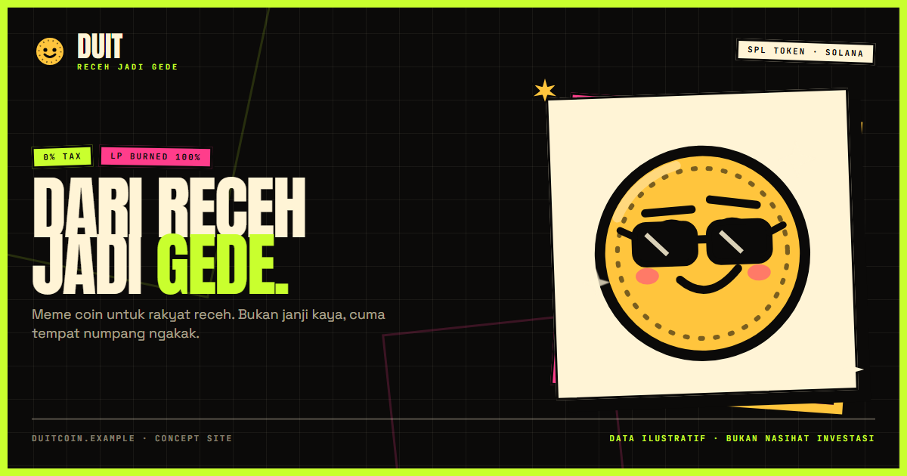

# DUIT — Meme Coin Concept Site



> **Ini konsep desain, bukan produk keuangan.** Tidak ada token yang benar-benar diluncurkan,
> tidak ada penawaran investasi, dan semua harga/statistik di halaman adalah data ilustratif.

Situs landing page meme coin fiktif **$DUIT** ("Receh jadi gede") — dibangun dengan estetika
**Neo-Brutalism 70% + Degen 30%**: border tebal, hard shadow tanpa blur, warna flat jenuh,
tipografi poster, dan angka-angka yang berteriak seperti terminal trading jam 3 pagi.

## Isi halaman

| Section | Isi |
|---|---|
| Hero | Headline "Dari Receh Jadi Gede", maskot Pak Duit, contract address + copy button, statistik |
| Ticker | Marquee harga & fakta token (pause saat hover, `motion-reduce` aman) |
| Duitmeter (`#chart`) | Candlestick SVG interaktif 4 rentang waktu, crosshair + tooltip OHLC, live-trades feed, statistik pasar |
| Tokenomics (`#tokenomics`) | Supply 1 M, alokasi 5 pos, 0% tax, LP burned, mint revoked |
| Meme Vault (`#galeri`) | 12 meme original, filter, tombol like, lightbox dengan navigasi keyboard |
| Cara Beli (`#cara-beli`) | 4 langkah, peringatan "selalu cek CA" |
| Roadmap (`#roadmap`) | 4 fase dengan status, fase aktif ditandai |
| Komunitas (`#komunitas`) | 4 kanal sosial (jumlah ilustratif) |
| FAQ (`#faq`) | 8 pertanyaan, accordion `<details>` tanpa JS |
| CTA + Footer | Penutup lime, disclaimer risiko, kontrak, navigasi |

Halaman lain: `/og` (kartu share 1200×630) dan halaman 404 kustom.

## Stack

- **Next.js 16.4** (App Router, Turbopack) + **React 19** + **TypeScript 5.9** (strict)
- **Tailwind CSS v4** — design token di `app/globals.css` (`@theme`)
- Font: **Anton** (display), **Space Grotesk** (body), **JetBrains Mono** (data) via `next/font`
- Tanpa library chart, tanpa gambar eksternal — semua ilustrasi SVG inline
- `clsx` + `tailwind-merge` untuk helper `cn()`

## Menjalankan

```bash
pnpm install
pnpm dev          # http://localhost:3000
pnpm build        # produksi
pnpm start        # jalankan hasil build
pnpm typecheck    # tsc --noEmit
```

## Struktur

```
app/
  layout.tsx            # font, metadata, Open Graph
  page.tsx              # komposisi semua section (Server Component)
  globals.css           # token warna/font/shadow/animasi + utilities
  not-found.tsx         # 404 kustom
  og/page.tsx           # kartu share 1200×630 (di-capture ke public/og.png)
components/
  art/mascot.tsx        # maskot Pak Duit — SVG parametrik (8 mood × 9 aksesori)
  art/props.tsx         # properti dekoratif (sparkle, rocket, diamond, dll)
  sections/
    hero.tsx            # hero + maskot + contract box + ticker
    chart-section.tsx   # shell server untuk Duitmeter
    chart-canvas.tsx    # candlestick SVG interaktif (client)
    chart-trades.tsx    # live trades + order book simulasi (client)
    tokenomics-section.tsx
    meme-vault.tsx      # section Meme Vault
    how-to-buy.tsx      # cara beli 4 langkah
    roadmap.tsx         # roadmap 4 fase
    community-section.tsx
    faq-section.tsx     # accordion <details>
    cta-band.tsx        # penutup lime
  site/                 # nav, ticker, footer, icons, contract box
  ui/                   # button, card, sticker, section/Container/SectionHead/Kicker
  meme-vault/           # vault-explorer (state), vault-card, filter-bar, lightbox, tone, prop-deco
lib/
  site.ts               # brand, contract, market stats, demoNote  ← ubah data di sini
  market-series.ts      # generator OHLC deterministik untuk chart
  meme-data.ts          # 12 data meme untuk galeri
  utils.ts              # cn(), formatId(), truncateMiddle()
DESIGN.md               # design system + build contract (sumber kebenaran visual)
```

## Design system

| Token | Hex | Peran |
|---|---|---|
| `void` | `#0B0A09` | latar gelap |
| `paper` | `#FFF4D6` | latar krem / permukaan |
| `ink` | `#0B0A09` | teks & border di permukaan terang |
| `lime` | `#C9FF2E` | aksen utama / CTA |
| `pink` | `#FF3D8B` | aksen kedua / peringatan |
| `gold` | `#FFC53D` | koin / uang |
| `up` | `#2BFF88` | harga naik (hanya di latar gelap) |
| `down` | `#FF4D4D` | harga turun (hanya di latar gelap) |
| `muted` / `muted-ink` | `#8B8270` / `#5E574A` | teks sekunder |

Palet disusun sendiri (bukan dari Color Hunt), dipetakan ke peran, dicek kontrasnya (teks biasa
di atas krem/hitam memenuhi WCAG AA). Shadow: `shadow-hard`, `shadow-hard-lg`, `shadow-lime`,
`shadow-paper`. Animasi: `animate-marquee`, `animate-float`, `animate-spin-slow`, `animate-blink`,
`animate-wiggle`, `animate-pop` — semua dimatikan saat `prefers-reduced-motion`.

## Data & copy

- Semua angka pasar, holder, like, dan transaksi **fiktif**. `demoNote` di `lib/site.ts` muncul
  di section data dan footer.
- Tidak ada klaim keuntungan, harga target, audit nyata, atau kemitraan nyata.
- Untuk mengganti menjadi proyek nyata: ubah `lib/site.ts` (nama, ticker, contract, market),
  ganti `lib/market-series.ts` dengan API harga sungguhan, lalu perbarui copy di
  `components/sections/*`.

## Aksesibilitas & performa

- Semantic landmark, urutan heading, `focus-visible` di semua elemen interaktif, skip link.
- Lightbox: `role="dialog"`, `aria-modal`, Esc/panah, focus kembali ke trigger, scroll lock.
- `prefers-reduced-motion` dihormati; marquee bisa di-pause dengan hover/fokus.
- Tidak ada request gambar eksternal; ilustrasi SVG inline. Font di-self-host lewat `next/font`.
- Responsif 360px → desktop lebar, tanpa scroll horizontal.

## Lisensi & kredit

Konsep, nama, maskot "Pak Duit", dan seluruh ilustrasi SVG dibuat original untuk proyek ini.
Tidak ada karakter, logo, atau merek pihak ketiga yang dipakai. Bebas dipakai sebagai referensi
desain/portofolio. Nama DEX/dompet yang disebut (Jupiter, Raydium, Phantom, Solflare, Backpack)
hanya contoh ekosistem Solana, bukan afiliasi.
